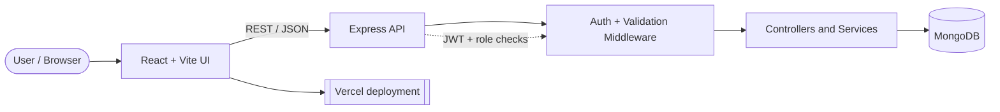

<!--
  Icons: Font Awesome 6 SVGs served via the Iconify API (fa6-solid / fa6-brands).
  Recolor any icon by changing ?color=%23HEX in its URL.
  Palette: violet #8B5CF6 | pink #EC4899 | amber #F59E0B | cyan #22D3EE | green #22C55E
-->

  

  

  
  
  
  
  

  
  
  
  

   <strong>Sri Lanka</strong>
  &nbsp;&nbsp;│&nbsp;&nbsp;
   <strong>Seeking Software Engineering Internship / Junior Developer roles</strong>
  &nbsp;&nbsp;│&nbsp;&nbsp;
   <strong>Open to meaningful projects</strong>

 

>  I build practical, reliable, and user-friendly software with a focus on full-stack web development, clean interfaces, and maintainable backend systems.

 

##  About Me

I'm a Software Engineering student in Sri Lanka who enjoys turning requirements into complete, working products: planning the features, designing the interface, building the API, and deploying the result. My core stack is the **MERN** stack (MongoDB, Express.js, React, Node.js), and I also work with **Java, PHP, Python and Android (Java/Kotlin)**. I'm currently looking for an internship or junior developer role where I can contribute to real products and keep learning from experienced engineers.

<table>
  <tr>
    <td width="50%" valign="top">
      <h4> Building</h4>
      Full-stack applications and interactive web projects
    </td>
    <td width="50%" valign="top">
      <h4> Learning</h4>
      Scalable architecture, secure authentication, and better software design
    </td>
  </tr>
  <tr>
    <td width="50%" valign="top">
      <h4> Interested in</h4>
      APIs, dashboards, e-commerce, UI/UX, developer tools, and machine learning on EEG data
    </td>
    <td width="50%" valign="top">
      <h4> Collaboration</h4>
      Useful products, practical solutions, and continuous improvement
    </td>
  </tr>
</table>

 

##  Education

| | Qualification | Institution | Period |
| :-: | --- | --- | --- |
|  | **BSc (Hons) Software Engineering** (Third Year Top-Up) | University of Bedfordshire, delivered with SLIIT City Uni (Northern / Jaffna campus) | Starting Sep 2026 · expected graduation **2027** |
|  | **Higher Diploma in Information Technology (HDIT)** | SLIIT City Uni | Oct 2023 – Dec 2025 |

 

##  Experience

<table>
  <tr>
    <td width="60" align="center"></td>
    <td>
      <strong>Web Development Intern (Virtual)</strong> · Syntecxhub 
       April – May 2026 &nbsp;·&nbsp; 1 month
      <ul>
        <li>Built <strong>4 full-stack applications</strong> with React.js, Node.js, Express.js, MongoDB and Tailwind CSS</li>
        <li>Delivered a user management system with authentication and role-based access control</li>
        <li>Built an employee management system with attendance, salary, documents, notifications and 2FA</li>
        <li>Built an expense tracker with budgets and spending insights, and a product REST API with validation and image handling</li>
        <li>Deployed projects to Vercel and managed source with Git and GitHub</li>
      </ul>
    </td>
  </tr>
</table>

 

##  Profile

| | Area | Details |
| :-: | --- | --- |
|  | **Role** | Software Engineering student and aspiring Full-Stack Developer |
|  | **Location** | Sri Lanka |
|  | **Looking for** | Software Engineering Internship or Junior Developer role |
|  | **Experience focus** | MERN applications, REST APIs, CRUD systems, and responsive interfaces |
|  | **Current learning** | Scalable backend architecture, secure authentication, and better software design |
|  | **Research interest** | Self-supervised and machine learning for EEG brain-state analysis |

 

##  Tech Stack

<h4> Languages</h4>

  

<h4> Frontend</h4>

  
  

<h4> Backend, APIs and Data</h4>

  
  
  

<h4> Mobile</h4>

  

<h4> Tools and Platforms</h4>

  

<h4> Development Practices</h4>

  
  
  
  
  
  
  
  
  
  

 

##  Core Skills

<table>
  <tr>
    <td width="50%" valign="top">
       <strong>Frontend development</strong> 
      Responsive layouts, component-based interfaces, forms, client-side interactions, and reusable UI
    </td>
    <td width="50%" valign="top">
       <strong>Backend development</strong> 
      Express servers, RESTful endpoints, validation, CRUD operations, and API integration
    </td>
  </tr>
  <tr>
    <td width="50%" valign="top">
       <strong>Authentication and authorization</strong> 
      Login/signup flows, JWT authentication, role-based access, 2FA, profiles, and admin dashboards
    </td>
    <td width="50%" valign="top">
       <strong>Database-driven applications</strong> 
      Product, user, employee, student, order, and expense data management
    </td>
  </tr>
  <tr>
    <td width="50%" valign="top">
       <strong>Application features</strong> 
      Search, filtering, favorites, notifications, dark mode, image handling, and reporting
    </td>
    <td width="50%" valign="top">
       <strong>Problem-solving</strong> 
      Breaking requirements into features, debugging issues, and improving usability
    </td>
  </tr>
  <tr>
    <td width="50%" valign="top">
       <strong>Project delivery</strong> 
      Planning, implementation, version control, deployment on Vercel, and iterative improvement
    </td>
    <td width="50%" valign="top">
       <strong>Research and analysis</strong> 
      Reading papers, comparing methods against baselines, and writing up findings
    </td>
  </tr>
</table>

 

##  How I Build

  
  
  
  
  
  
  
  
  

1. **Understand** the requirement and define the core features.
2. **Design** a clear and responsive user experience.
3. **Build** reusable frontend components and structured backend services.
4. **Connect** APIs and data models with validation and error handling.
5. **Ship** by testing, refining, documenting, and deploying the application.

###  Typical architecture of my MERN projects

 

##  What I Build

|  Web Apps |  Business Systems |  Backend Services |
| --- | --- | --- |
| Responsive React interfaces, dashboards, and interactive experiences | E-commerce, user, employee, student, and expense management systems | REST APIs, CRUD services, authentication, validation, and data workflows |

 

##  Selected Work

<table>
  <tr>
    <td width="50%" valign="top">
      <h3> E-commerce Platforms</h3>
      
Full-stack shopping experiences with product management, authentication, orders, payments, responsive design, and admin workflows.

      
    </td>
    <td width="50%" valign="top">
      <h3> Management Systems</h3>
      
Data-driven applications for users, employees, students, attendance, salaries, profiles, and role-based administration.

      
    </td>
  </tr>
  <tr>
    <td width="50%" valign="top">
      <h3> Interactive Experiences</h3>
      
Browser games and engaging interfaces with timers, scoring, achievements, streaks, API-powered content, and responsive gameplay.

      
    </td>
    <td width="50%" valign="top">
      <h3> APIs and Utilities</h3>
      
RESTful services and focused tools that solve practical problems through clear data models, validation, and simple user experiences.

      
    </td>
  </tr>
</table>

 

##  Featured Projects

| | Project | Description | Stack |
| :-: | --- | --- | --- |
|  | [**My Store**](https://github.com/Sajee119/my-store) | A production-ready MERN e-commerce platform with dark mode, shopping features, and an admin dashboard. | `MongoDB` `Express` `React` `Node.js` |
|  | [**User Management System**](https://github.com/Sajee119/Syntecxhub_User_Management_System) | A full-stack system with authentication, role-based access control, profiles, admin tools, and REST APIs. | `MERN` |
|  | [**Employee Management System**](https://github.com/Sajee119/Syntexhub_Employee_Management_System) | An employee platform with attendance, salary management, document handling, notifications, and 2FA. | `MERN` |
|  | [**Expense Tracker**](https://github.com/Sajee119/syntecxhub-expense-tracker-app) | Income, expense, category, budget, and spending insights in one dashboard. | `MERN` |
|  | [**Recipe Finder App**](https://github.com/Sajee119/Recipe_Finder_App) | A responsive recipe discovery app with categories, areas, recipe details, favorites, and a chat helper. | `React` `Vite` |
|  | [**Product API**](https://github.com/Sajee119/product-api) | A RESTful product management API with CRUD operations, validation, image handling, and scalable architecture. | `JavaScript` `Node.js` |
|  | [**Banana Quiz Game**](https://github.com/Sajee119/Banana-Quiz-Game) | A timed browser game with puzzle solving, scoring, streaks, achievements, and leaderboard progress. | `JavaScript` |
|  | [**Banana Quest**](https://github.com/Sajee119/banana-quest) | A game development project with a React/Vite client and Express server. | `React` `Vite` `Express` |
|  | [**Student Management System**](https://github.com/Sajee119/Student-management-System) | A command-line application for managing students, courses, grades, and academic records. | `Python` |

###  Project Deep Dives

 <strong>My Store</strong> — MERN e-commerce platform

 

- **Customer side:** product browsing, search and filtering, favorites, cart and orders, dark mode
- **Admin side:** dashboard for managing products, orders and users
- **Under the hood:** authentication, payments, image handling, responsive layout
- **Stack:** MongoDB · Express · React · Node.js
- **Repo:** [Sajee119/my-store](https://github.com/Sajee119/my-store)

 <strong>User Management System</strong> — auth and role-based access

 

- **Access control:** login/signup, JWT authentication, role-based permissions
- **Features:** user profiles, admin tools for managing accounts
- **Backend:** REST APIs with validation and error handling
- **Live:** [Open the app](https://syntecxhub-user-management-system-eight.vercel.app) · **Repo:** [Syntecxhub_User_Management_System](https://github.com/Sajee119/Syntecxhub_User_Management_System)

 <strong>Employee Management System</strong> — attendance, salary and 2FA

 

- **HR features:** attendance tracking, salary management, document handling
- **Engagement:** notifications for employees and admins
- **Security:** two-factor authentication and role-based administration
- **Live:** [Open the app](https://syntexhub-employee-management-syste.vercel.app) · **Repo:** [Syntexhub_Employee_Management_System](https://github.com/Sajee119/Syntexhub_Employee_Management_System)

 <strong>Expense Tracker</strong> — budgets and spending insights

 

- **Tracking:** income and expense entries organised by category
- **Planning:** budgets and spending insights
- **Live:** [Open the app](https://syntecxhub-expense-tracker-app.vercel.app) · **Repo:** [syntecxhub-expense-tracker-app](https://github.com/Sajee119/syntecxhub-expense-tracker-app)

 <strong>Banana Quiz Game</strong> — timed puzzle game

 

- **Gameplay:** timers, puzzle solving, scoring and streaks
- **Progress:** achievements and leaderboard
- **Content:** API-powered puzzles in a responsive layout
- **Repo:** [Sajee119/Banana-Quiz-Game](https://github.com/Sajee119/Banana-Quiz-Game)

###  Live Projects

| | Project | Live preview |
| :-: | --- | --- |
|  | [Portfolio](https://github.com/Sajee119/Portfolio) | [ sajeepan-portfolio.vercel.app](https://sajeepan-portfolio.vercel.app/) |
|  | [CHAOSVERSE](https://github.com/Sajee119/CHAOSVERSE) | [ chaosverse-sajee.vercel.app](https://chaosverse-sajee.vercel.app) |
|  | [Expense Tracker](https://github.com/Sajee119/syntecxhub-expense-tracker-app) | [ Open live app](https://syntecxhub-expense-tracker-app.vercel.app) |
|  | [User Management System](https://github.com/Sajee119/Syntecxhub_User_Management_System) | [ Open live app](https://syntecxhub-user-management-system-eight.vercel.app) |
|  | [Employee Management System](https://github.com/Sajee119/Syntexhub_Employee_Management_System) | [ Open live app](https://syntexhub-employee-management-syste.vercel.app) |

 

##  Other Projects

-  [**CHAOSVERSE**](https://github.com/Sajee119/CHAOSVERSE) — Interactive web experience
-  [**Portfolio**](https://github.com/Sajee119/Portfolio) — Personal portfolio website
-  [**Event-Driven Programming Practical Lab**](https://github.com/Sajee119/Event-Driven-Programming-Practical-Lab) — JavaScript event handling and delegation exercises
-  [**User Profile Management**](https://github.com/Sajee119/User-Profile-Management) — Java-based profile management system

 

##  Research Interests

<table>
  <tr>
    <td width="60" align="center"></td>
    <td>
      <strong>EEG and machine learning</strong> 
      For my final-year research I'm exploring <strong>self-supervised learning for personalised EEG brain-state representation</strong>: contrastive pre-training on public EEG datasets, few-shot adaptation to individual users, and comparison against supervised baselines.
    </td>
  </tr>
</table>

 

##  Engineering Mindset

<table>
  <tr>
    <td align="center" width="20%"> <strong>Simple interfaces</strong> Easy to understand and use</td>
    <td align="center" width="20%"> <strong>Reusable components</strong> Less duplication, more maintainability</td>
    <td align="center" width="20%"> <strong>Clear APIs</strong> Predictable data flow</td>
    <td align="center" width="20%"> <strong>Secure access</strong> Protected user workflows</td>
    <td align="center" width="20%"> <strong>Continuous improvement</strong> Ship better with every project</td>
  </tr>
</table>

 

##  Currently Exploring

-  Improving backend structure and scalable API design
-  Building more secure authentication and authorization flows
-  Creating accessible, responsive, and polished user interfaces
-  Strengthening testing, debugging, documentation, and deployment practices
-  Turning project ideas into complete, useful products

 

##  Goals

| | Goal | Status |
| :-: | --- | --- |
|  | Land a Software Engineering Internship or Junior Developer role |  |
|  | Complete the BSc (Hons) Software Engineering top-up by 2027 |  |
|  | Build production-grade, secure authentication into every full-stack project |  |
|  | Deliver the EEG self-supervised learning research artefact |  |

 

##  GitHub Analytics

  
  

  

  

  

 

##  Let's Connect

| | Channel | Link |
| :-: | --- | --- |
|  | Portfolio | [sajeepan-portfolio.vercel.app](https://sajeepan-portfolio.vercel.app/) |
|  | LinkedIn | [sivanadaraja-sajeepan](https://linkedin.com/in/sivanadaraja-sajeepan) |
|  | GitHub | [Sajee119](https://github.com/Sajee119) |
|  | X | [@SSajeepan3492](https://twitter.com/SSajeepan3492) |
|  | Email | [sajeepan634@gmail.com](mailto:sajeepan634@gmail.com) |

  
  
  

  
  <i>Thanks for visiting my profile. Let's build something useful together.</i>

  

